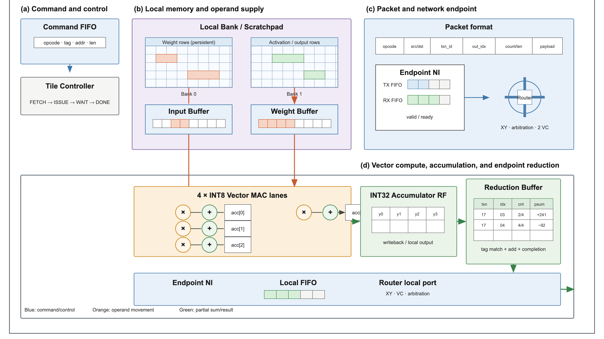
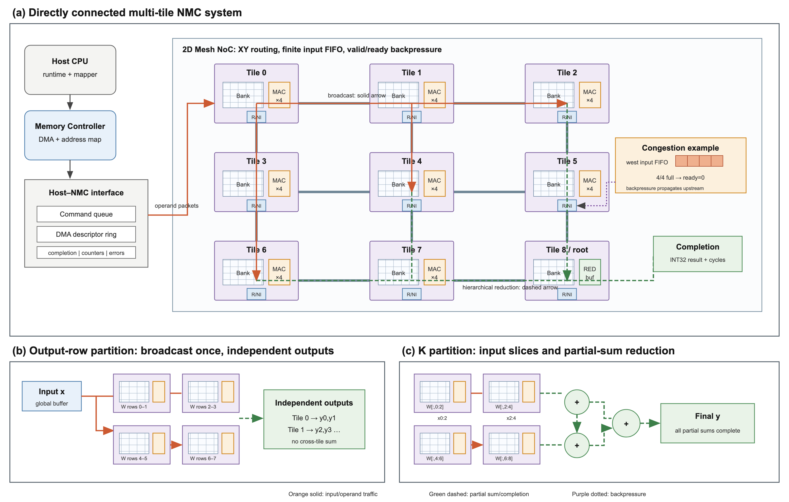
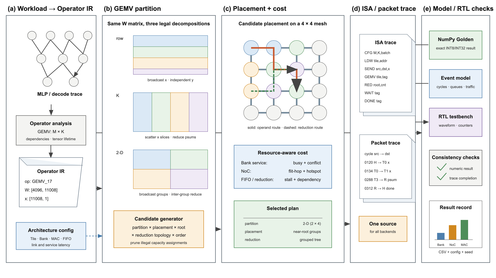

# Digital NMC Research Platform

面向 GEMV 的数字近存计算（NMC）研究平台，研究有限 Bank、MAC、NoC 带宽和 FIFO 条件下的切分、放置与端点归约。

当前提供 8×8/64 物理 Tile 的 GEMV 周期模型，支持 ROW/K/二维分块、compact/spread 放置、有限队列及集中/树归约；保留原 2×2 Demo 与接口。输入经 MEM_WRITE/ACK 后启动计算，Root 发送唯一全局 Done。新增自动映射搜索在共同候选目录内比较 UniNDP 方法适配与通信感知排序，再用同一个有限资源 evaluator 验证前 K 项。

64 Tile 集成 RTL 已接通真实 Tile SRAM/MAC、NI、XY Router、归约与 Done，包含 16/32 个活跃计算 Tile、反压和复位重放用例；独立归约端点与 Python 逐边沿对齐。Python 的输入写提交仍为功能操作，RTL 使用真实窄 X 写端口和注册 NI，完整系统周期偏差单独报告。完整芯片综合及 PPA 不在当前验证范围。早期 RV32I CPU 示例仅作本地学习参考。

## 从这里开始

- 定义计算/通信接口：[Compute v0.1](docs/spec/compute_architecture_v0.1.md)、[Communication v0.1](docs/spec/communication_architecture_v0.1.md)。
- 运行 Demo：[Demo 0 指南](docs/validation.md#demo0)、[Comm 0A–0C 记录](docs/validation.md#comm)、[NMC Demo 1](docs/validation.md#demo1)、[NMC Demo 2](docs/validation.md#demo2)。
- Mapper：[v0.1 使用说明与规则](src/compiler/README.md)。
- 实验：[Root 接收压力](tools/experiments/pressure_sweep.md)、[Compute/SRAM 参考时序对照与单 Tile 逐请求验证](tools/experiments/compute_timing.md)。另见 [Tile 端口与 Bank 参考合同](docs/spec/compute_architecture_v0.1.md#92-单-tile-端口与-bank-参考组织2026-10-28-补充)；默认 Demo 行为不变，端点归约仍为功能操作。
- 硬件验证：[单 Tile RTL](src/rtl/nmc_tile/README.md)，包含 SRAM/控制/MAC 和 Python 逐周期对照；另两台电脑的分工见 [并行推进计划](docs/parallel_work.zh-CN.md)。
- Root 时序：[有限接收/部分和/Done 资源与服务合同](docs/spec/root_service_v0.1.md)，含独立手算 Trace 和同配置 ROW/K 实验；[宽写回 RTL 校准](docs/spec/root_writeback_rtl_v0.1.md) 包含 ready/valid、Bank 仲裁、错误原子性和 51 组逐周期对照。
- 同硬件自动映射：[v0.3 搜索合同](docs/spec/mapping_search_v0.3.md)，含 UniNDP 原方法核对、适配边界、通信感知选择和 1/2/4/8 次精确模拟预算；[对照指标](docs/unindp_evaluation.zh-CN.md)。
- 集成硬件验证：[64 Tile RTL](src/rtl/nmc_mesh/README.md)，包含九项闭环用例和独立端点的逐周期对照。
- 最新结果：[映射质量/预算实验与强基线核查](data/results/mapping_search_20261028/README.md)、[64 Tile RTL 数据](data/results/mesh_rtl_20261028/README.md)。更强默认放置基线下，NoC 低预算略慢；预算 4/8 双方命中当前目录最优。保留反证，不把任意同分放置造成的差距当作收益。
- 64 Tile 主实验：[v0.2 执行合同](docs/spec/scalable_execution_v0.2.md) 复用原 Tile/Root/NoC，提供 ROW/K/二维分块、集中/分层归约；[三台电脑运行说明](docs/distributed_experiments.zh-CN.md) 使用固定 112 项清单、续跑和严格合并。
- 阅读计划：[团队路线](docs/project_plan.zh-CN.md)、[Proposal](docs/proposal.md)。文献调研保存在本地 `docs/papers/`，不随 GitHub 仓库发布。
- 使用 VS Code：直接打开仓库根目录。本地的 `Digital-NMC.code-workspace` 与论文工作区为可选配置，不是运行依赖。

## 目录

```text
computer architecture project/
├── src/                 # 代码：Python 模型、Mapper、RTL、测试
│   ├── hardware.py      # 统一硬件资源配置（SRAM、Bank、FIFO、Mesh）
│   ├── simulator/
│   ├── compiler/
│   ├── rtl/             # legacy_cpu/ 仅为早期示例
│   ├── fpga/            # 后续可选
│   └── tests/
├── ini/                 # 模型/实验配置；保留实际格式 .cfg/.yaml
├── tools/               # 检查工具、实验运行与绘图脚本
├── data/                # 工作负载和精选实验结果
├── dump/                # 可重建的运行输出、trace、波形
├── lib/                 # 本地作者仓库：PIMCOMP-NN、pimsim-nn、UniNDP
└── docs/                # 规范、架构图、计划、论文和验证记录
```

目录参考 [SAITPublic/PIMSimulator](https://github.com/SAITPublic/PIMSimulator/tree/dev) 的 `src / src/tests / ini / tools / data / dump / lib`。为本项目额外保留 `docs`，集中存放说明和论文。只参考工程组织，不改变既有数字 NMC 架构。星标与适用范围见 [目录依据和迁移表](docs/README.md#layout)。

## 环境和运行

在仓库根目录执行：

```bash
python3 -m venv .venv
source .venv/bin/activate
python -m pip install -r requirements.txt

# 全部当前测试
python -m pytest -q -p no:cacheprovider
# Compute Demo 0
python -m pytest -q -p no:cacheprovider src/tests/test_demo0_functional.py
# Packet + Comm 0A–0C
python -m pytest -q -p no:cacheprovider src/tests/test_communication_v0_1.py
# 多 Tile NMC Demo 1：打印计算/通信事件，并保存 Trace
PYTHONPATH=src python -m simulator.system.demo1 --trace dump/demo1_trace.json
# Demo 1 验收测试
python -m pytest -q -p no:cacheprovider src/tests/test_nmc_demo1.py
# NMC Demo 2：K 切分与 PSUM 归约
PYTHONPATH=src python -m simulator.system.demo2 --trace dump/demo2_trace.json
python -m pytest -q -p no:cacheprovider src/tests/test_nmc_demo2.py
# Mapper v0.1：生成计划
PYTHONPATH=src python -m compiler.auto_mapper_v0_1 --workload data/workloads/demo1_gemv.json --strategy auto -o dump/mapper_plan.json
PYTHONPATH=src python -m compiler.auto_mapper_v0_1 --demo --strategy k --k-split 1
PYTHONPATH=src python -m compiler.auto_mapper_v0_1 --self-test
# Demo CLI 直接执行计划；--workload 可选，用于 golden 校验
PYTHONPATH=src python -m simulator.system.demo1 --plan dump/mapper_plan.json --workload data/workloads/demo1_gemv.json
PYTHONPATH=src python -m compiler.auto_mapper_v0_1 --workload data/workloads/demo1_gemv.json --strategy k -o dump/mapper_plan_k.json
PYTHONPATH=src python -m simulator.system.demo2 --plan dump/mapper_plan_k.json --workload data/workloads/demo1_gemv.json
python -m pytest -q -p no:cacheprovider src/tests/test_mapper_v0_1.py src/tests/test_plan_runner.py
# 批量计划对比：ROW/K × worker/Root 放置，输出 JSON/CSV
PYTHONPATH=src python tools/experiments/mapper_sweep.py --demo --placements all --output data/results/mapper_sweep_demo.json --csv data/results/mapper_sweep_demo.csv
PYTHONPATH=src python tools/experiments/mapper_sweep.py --workload data/workloads/demo1_gemv.json --k-splits all
# 形状矩阵：suite = frontier + half + extremes + aspect
PYTHONPATH=src python tools/experiments/mapper_sweep.py --shapes suite --output data/results/mapper_sweep_suite.json --csv data/results/mapper_sweep_suite.csv
PYTHONPATH=src python tools/experiments/mapper_sweep.py --shapes 16x128,128x16,32x64,64x32 --top 2
python -m pytest -q -p no:cacheprovider src/tests/test_mapper_sweep.py
# 详细 Tile SRAM/Bank 时序，与 NI/Mesh 共用时钟；--plan 同样支持这些选项
PYTHONPATH=src python -m simulator.system.demo1 --compute-model tile --tile-config ini/tile_system/baseline.json --tile-trace --trace dump/tile_row.json
PYTHONPATH=src python -m simulator.system.demo2 --compute-model tile --tile-config ini/tile_system/result_1bank.json --trace dump/tile_k.json
python tools/experiments/timed_tile_system.py --output-dir dump/timed_tile_system_20261028
# 同时启用实际有限 Root 服务；不需要人工接收压力窗口
PYTHONPATH=src python -m simulator.system.demo2 --compute-model tile --root-model timed --root-trace --trace dump/root_k.json
python tools/experiments/finite_root_system.py --output-dir dump/finite_root_system_20261028
# 检查随 Git 发布的文档链接
python tools/check_layout.py --tracked
```

Python 导入路径为 `src`，包名仍为 `simulator`；直接运行解释器时使用 `PYTHONPATH=src`。已有 `.venv` 保留在根目录，无需因目录整理重装环境。

## 总体架构







以上为规划图，不能当作 RTL 或性能实验结果。FPGA 为可选验证，不属于当前完成条件。

## 协作与文件规则

- 接口修改先更新 `docs/spec/`，重要决定记录到 `docs/spec/design_decisions_v0.1.md`。
- 测试源码放 `src/tests/`，原始输出放 `dump/`，精选结果放 `data/results/`。
- 本地论文 `docs/papers/`、作者仓库 `lib/`、虚拟环境和大型输出不上传 GitHub。
- 分支和 PR 工作流程见 [CONTRIBUTING](CONTRIBUTING.md)。

许可证仍待团队确认；没有因为参考目录结构而采用对方的许可证。
