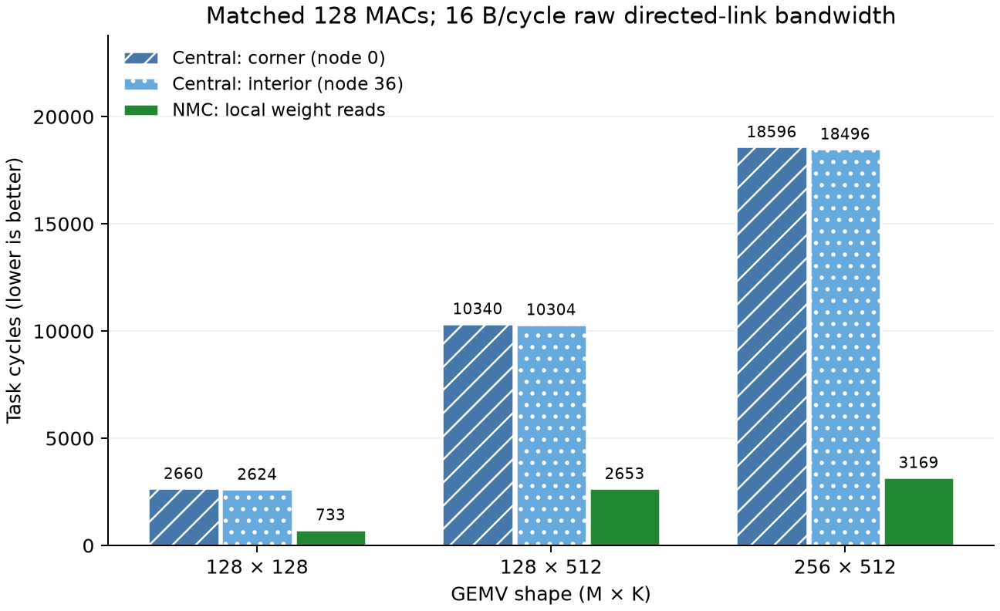
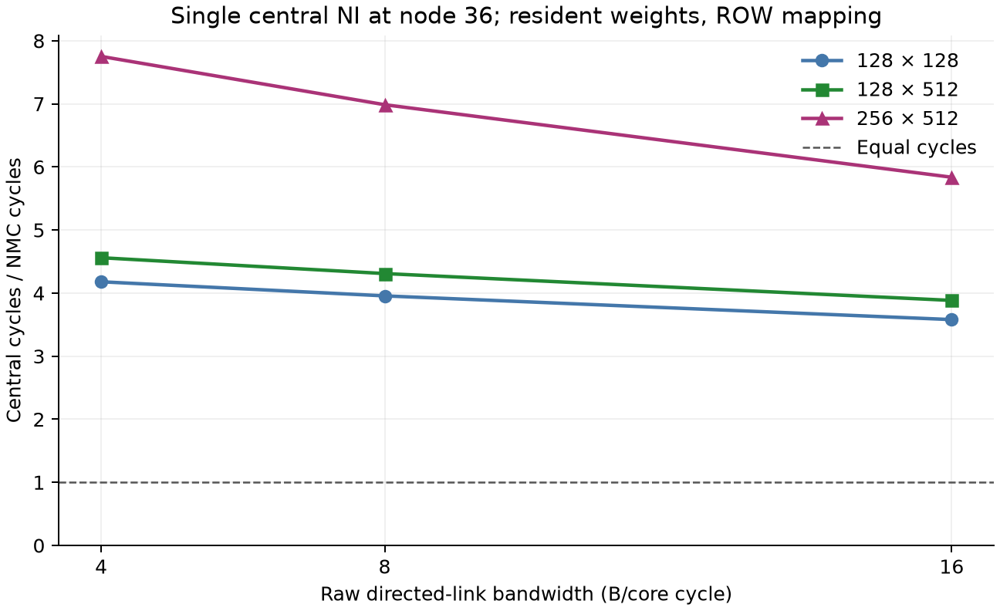

# 第一轮：同计算/存储预算的 Central 与 NMC 对照

**结论：在本轮固定 ROW、权重驻留、单集中 NI 的 Python 模型中，NMC 的本地权重读取明显降低任务周期。**
27 个实验点全部与独立 INT32 点积 Golden 一致，形成 18 对架构比较。整轮运行约 129 秒。
这填补了“不同 NMC 映射互比”之外的第一项架构对照，但尚不能证明所有集中架构都不如 NMC。

## 对照合同

完整资源与计时定义见[实验规范](../../../docs/spec/central_nmc_comparison_v0.1.md)。

| 项目 | 两边共同预算/条件 |
|---|---|
| 网络 | 8×8、XY、128-bit Flit、4-Flit Router/NI FIFO |
| 存储节点 | 固定 32 个节点，每个 4 KiB W，共 128 KiB 活跃权重容量 |
| 计算 | 32 组 × 4 Lane = 128 MAC；相同请求级控制器 |
| 每组 X/Y | 各 1 KiB；X 每周期 1 B，Y 四 Bank |
| W 读取 | 每个 Bank 每周期 4 B，一周期同步读 |
| 集中预取 | 每组最多 8×16 B 在途数据；消费后信用经网络返回 |
| 输入/输出 | x 从 Host 0 向 32 组各复制一份；最终 INT32 y 写入 Host 0 |
| 分块/数据 | 相同 ROW 分块、相同存储节点、相同随机 INT8 W/x |
| 区别 | NMC 在存储节点计算；Central 把全部计算组和 X/Y 搬到单个节点，W 留在原 Bank |

64 个物理 Router 不等于 64 个活跃计算 Tile；本轮只激活 32 组，以保留固定的两个集中位置候选。
同容量/端口预算不等于已证明同面积、同最高频率或同功耗。

计时从 Host 输入就绪、开始分发/预取，到输出写好且计算和网络排空；不计权重外部加载、配置、量化。
预取可以与输入传输重叠。`host_output_ready_cycles` 单独保留，避免把信用尾部排空隐藏在输出时间中。
新增流式端点尚未与 RTL 对齐，**以下不是此前 64 Tile RTL 的实测加速比**，也不能直接拼接旧输入协议的结果。

## 结果

每条有向链路原始带宽为 16 B/核心周期时：

| GEMV | NMC 周期 | Central 角落 0 | Central 内部 36 | 内部 Central / NMC |
|---|---:|---:|---:|---:|
| 128×128 | 733 | 2,660 | 2,624 | 3.58× |
| 128×512 | 2,653 | 10,340 | 10,304 | 3.88× |
| 256×512 | 3,169 | 18,596 | 18,496 | 5.84× |



图 1：相同任务完成口径，越低越好。两个集中位置均只连接一个 NI。形状和数值来自 `comparison.csv`；无随机采样误差条，因为这是固定 seed、固定仲裁的确定性模拟。

完整带宽敏感性（数值为 NMC / Central 0 / Central 36 周期）：

| GEMV | 16 B/cycle | 8 B/cycle | 4 B/cycle |
|---|---|---|---|
| 128×128 | 733 / 2660 / 2624 | 1318 / 5293 / 5214 | 2486 / 10561 / 10390 |
| 128×512 | 2653 / 10340 / 10304 | 4774 / 20653 / 20574 | 9014 / 41281 / 41110 |
| 256×512 | 3169 / 18596 / 18496 | 5290 / 37165 / 36958 | 9530 / 74305 / 73878 |



图 2：固定内部集中位置 36，纵轴为 Central/NMC 周期比。它说明本模型下带宽收敛的影响，不代表实测芯片或模型级推理收益。

## 为什么有收益，以及什么尚未证明

- Central 必须跨网络传输 16 / 64 / 128 KiB 权重；NMC 的权重网络负载为零，但仍执行本地 SRAM 读取，不能说没有读存储成本。
- 两边输入负载均为 `32×K` 字节，结果均为 `4×M` 字节。Central 另外承担权重和信用流量。
- 当前每 16 B 数据需要一个 16 B Header，故 16 B/cycle 的原始链路最多承载 8 B/cycle 的连续权重有效负载，还未扣除输入、结果和信用争用。这是显著的协议假设，不能隐藏。
- 把集中端从角落移到内部后优势仍存在，说明本轮结果主要来自单入口供给瓶颈，而非只来自角落跳数。
- 整体 MAC 利用率、Flit-hop、等待和输出就绪周期都在逐点 JSON/CSV 中。Flit-hop 是搬运量代理，不是焦耳；重叠的等待计数不能直接相加为周期分解。

**下一轮优先加强集中基线：**扫描更大的传输突发及更多集中入口/更宽入口，并明确为这些网络资源付出的预算；检查集中端 x 广播/共享和权重跨调用复用。随后再验证新端点 RTL 时序与冷加载。尚未覆盖 K/二维、多 Root、真实模型精度、4096×4096、PPA 或能耗。

本轮的可辩护结论是：在明确且共同的资源假设下，把计算靠近权重 Bank，能够避免单集中入口的权重供给瓶颈。若强集中基线缩小或反转收益，应照实保留。

## 复现与证据

仓库根目录，安装 `requirements.txt` 后运行：

```bash
python -m pytest -q -p no:cacheprovider src/tests/test_central_comparison.py
python tools/experiments/central_comparison.py --output-dir dump/central_round1
python tools/experiments/plot_central_comparison.py --input-dir dump/central_round1
```

- `provenance.json`：配置、seed、源码 SHA256、起始 commit、运行时间、27 点数值验收。
- `*x*_*.json`：实际 Host 输出、周期、流量、资源最大占用与输入哈希。
- `comparison.csv`：18 对比较，含输入/后续阶段、MAC 利用率、Flit-hop。
- `figures/*.svg`：文字可编辑；PNG 为预览；`figures/provenance.json` 绑定图与 CSV/绘图源码。
- 验证覆盖负数、非整 Lane/包尾、慢输出反压、单包信用、更大预取窗口、地址和容量错误。既有 Router/Tile/可扩展系统测试一起回归。

图表论点限定为任务周期与单入口带宽敏感性；未把未测的功耗或硬件实现收益画入图中。

本轮验收记录：新增测试与既有 Tile/Router/scalable-system 合计 **76 passed（3.60 秒）**；另从 seed 重建 27 点独立 Golden，核对 18 对 CSV、配置和七份源码哈希，全部一致。两幅 PNG 已检查，无裁切/重叠，SVG 保留文本与矢量对象。
