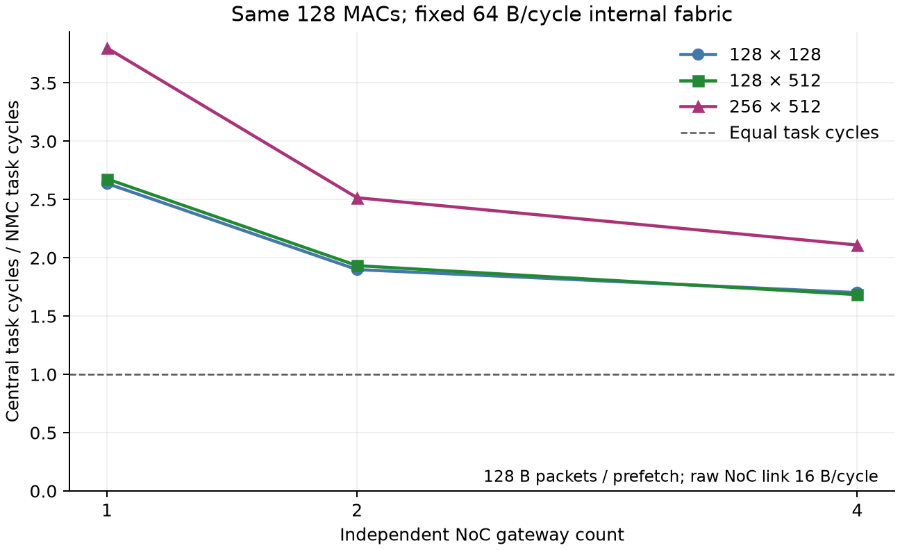
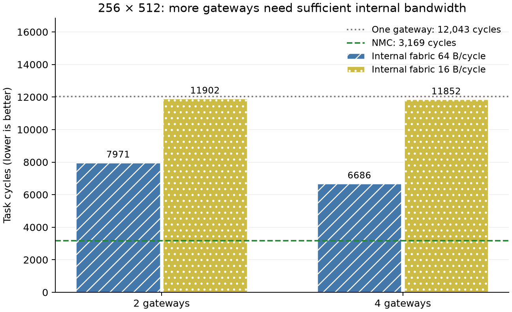

# 第三轮：独立多入口能否改善集中计算？

**结论：真实独立入口配合足够的内部带宽，明显改善集中端；只增加入口、保留窄内部汇集通道，收益很小。** 在本轮受控条件下 NMC 仍更快，但此前单入口差距进一步缩小。

共 35 点，全部 Host INT32 数值正确；10 个历史 legacy/NMC 点完全重现。整轮运行 258.9 秒。

## 什么变了，什么固定

- 同一套 128 MAC 始终位于集中阵列；Gateway 不做计算或归约。这不是多个 Root 或多个计算阵列。
- 原先 32 个权重 Bank、ROW 任务和 W/x 不变。启用 `[36]`、`[36,37]`、`[36,37,44,45]` 的独立 Router 本地端口，入口分配采用固定 Worker 列表轮询。
- 权重包与每簇预取空间都固定 128 B。NI/Router 保持四 Flit。每 Gateway 入/出队列固定有限深度，两边统一预留四入口最大容量预算，未用资源不重新分配。
- 主比较内部通道固定每方向 64 B/核心周期；窄通道对照为每方向 16 B/核心周期。每个入口仍最多 16 B/核心周期。
- 输入/权重、信用/结果都经过内部队列、仲裁与传播；128 B 权重包内部需九 Flit，Gateway 到阵列传播延迟为 1/2/2/3 周期。完整包到达后才交付计算。
- 每包开始内部传输前预留目的缓冲，预留覆盖传播中的包；整包存储、在途和输出队列均受限。
- 周期为驻留权重的任务完成口径，包含输入分发、计算、等待、输出和排空，不是纯 MAC；没有外部权重加载、配置、量化或新 RTL/PPA 验证。

完整协议与资源见[多入口合同](../../../docs/spec/central_multi_entry_v0.1.md)。增加入口会改变部分路由和内部连接，不能声称已经控制了物理面积或所有放置效应。

## 主结果：原始 NoC 链路 16 B/核心周期

| GEMV | NMC | 旧单入口 | 新单入口＋内部通道 | 双入口 | 四入口 | 四入口相对新单入口的周期减少 | 四入口/NMC |
|---|---:|---:|---:|---:|---:|---:|---:|
| 128×128 | 733 | 1,868 | 1,933 | 1,392 | 1,247 | 35.49% | 1.70× |
| 128×512 | 2,653 | 7,008 | 7,102 | 5,128 | 4,468 | 37.09% | 1.68× |
| 256×512 | 3,169 | 11,887 | 12,043 | 7,971 | 6,686 | 44.48% | 2.11× |

上述新 1/2/4 入口都使用同一内部通道定义、同一 64 B/周期聚合上限。旧单入口没有新增内部路径，仅用于追溯上一轮，不能混作本轮入口扩展的分母。



图 1：同一任务边界下 Central/NMC 周期比，分母是对应形状的 NMC；固定 seed、确定性仲裁，无统计误差条。

## 控制实验：内部通道是否真的限制吞吐？

256×512、原始 NoC 链路 16 B/周期：

| 入口数 | 内部 64 B/周期 | 内部 16 B/周期 |
|---|---:|---:|
| 2 | 7,971 | 11,902 |
| 4 | 6,686 | 11,852 |



图 2：增加接收位置不等于增加阵列实际供给能力。窄内部通道消耗真实传输周期，并通过有限 Gateway 槽位向 NoC 反压；它没有被绕过。

## 外部链路带宽敏感性

256×512，数值为任务总周期：

| 原始 NoC 链路带宽 | NMC | 新单入口/内部64 | 双入口/内部64 | 四入口/内部64 | 四入口/内部16 |
|---|---:|---:|---:|---:|---:|
| 16 B/cycle | 3,169 | 12,043 | 7,971 | 6,686 | 11,852 |
| 8 B/cycle | 5,290 | 23,214 | 14,290 | 12,946 | 14,408 |
| 4 B/cycle | 9,530 | 45,646 | 28,334 | 25,194 | 25,158 |

内部通道仍按核心时钟运行，外部链路变慢时其相对瓶颈程度会变化；不能将内部64解释成每条 NoC 链路也已变宽。最低带宽下，四入口/内部16 比内部64 少 36 周期（约 0.14%）；改变仲裁到达顺序会产生小幅反向变化，因此不强加“带宽越大，任务周期必定单调下降”的结论。

## 结论边界与后续

多入口实验确认：首轮集中模型的单 NI 是重要限制，强化基线后必须更新收益数字。保留所有反证与开销，不以维持某个加速比为目标。
当前仍存在每簇一包信用、整包组装/接收、输入逐簇复制、固定入口分配等限制。后续应分别测试预取容量和输入广播；是否继续加入口，需要先检查内部/NoC 利用率与资源代价。
所有入口都服务同一阵列，内部星形连接与预约控制是显式模型假设，未做物理布线/等面积证明。NMC 预留但不使用集中汇集资源也是预算约定。新增 RTL 校准仍后置，本结果不是芯片实测性能或能耗。

## 验证与复现

- **102 项相关测试通过（6.31 秒）**：包含独立手算九 Flit 包、传播延迟、双入口并行与单 Lane 串行仲裁、目的槽位预留和集成反压/尾包/负数。
- runner 校验 35 点 Golden、内部与 NoC 分类流量守恒、有限 Gateway 占用，以及 10 点历史输出/周期/通信量重放。
- JSON 保存逐入口流量、内部每周期最大吞吐、仲裁等待、实际 Host 输出和资源计数；CSV 是完整 35 点总表；provenance 保存源码/配置/输入哈希与耗时。

```bash
python -m pytest -q -p no:cacheprovider src/tests/test_central_fabric.py src/tests/test_central_comparison.py
python tools/experiments/central_entry_sweep.py --output-dir dump/central_entries
python tools/experiments/plot_central_entries.py --input-dir dump/central_entries
```

绘图脚本只读取保存的 CSV；SVG 保留文字，PNG 用于预览，图的输入/脚本哈希另存于 figures/provenance.json。

交付前独立重建了 35 点 Golden/输入哈希，核对 CSV、源码/配置哈希、各类流量守恒和资源上界，全部通过。两幅 PNG 已目视检查，SVG 保留可编辑文字。
