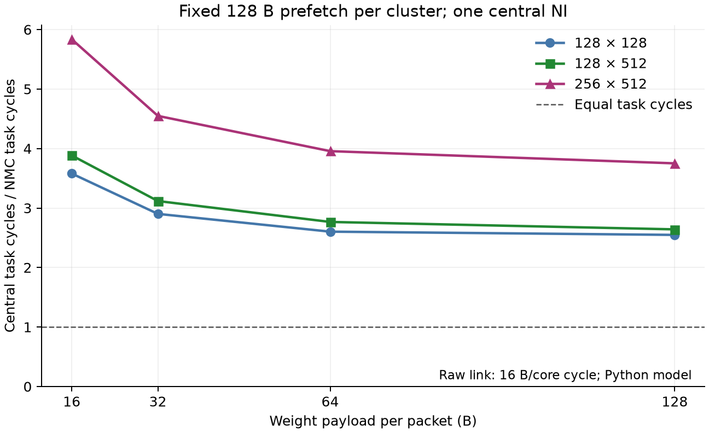
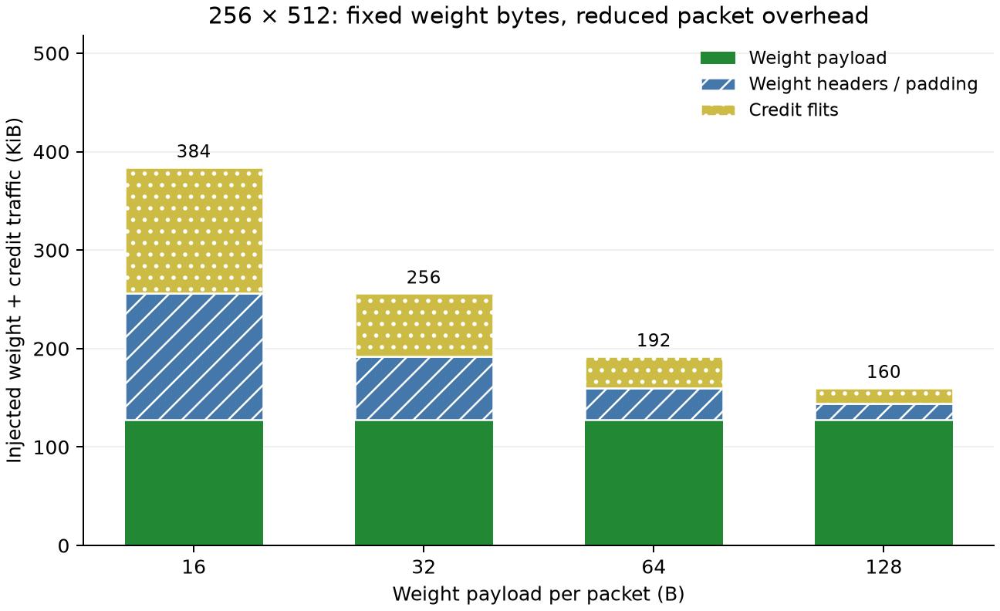

# 第二轮：扩大权重包，NMC 优势还剩多少？

**结论：大包明显改善集中计算，首轮的小包开销确实放大了差距；在本轮固定 128 B 预取空间、单集中 NI 的条件下，NMC 仍更快。**

本轮 45 点全部数值通过、36 对比较；18 个原 16 B/NMC 点的输出、关键周期、Flit-hop 和分类流量完全重现。运行耗时 392.9 秒。

## 实验边界

集中端是在一个网络节点后面放置 32 组四 Lane MAC，共 128 MAC，并不是原规格只有四 Lane 的 Tile。NMC 使用同样的 128 MAC；两边的权重 Bank、任务和最终 Host 输出位置相同。
固定 ROW、中心节点 36、驻留权重和三档链路带宽。输入仍给每簇复制一份，尚未加入集中广播、多入口、宽入口或 GEMM 权重复用。
任务总周期包含输入分发、存储访问、计算、等待、输出和排空，不是纯 MAC 周期；不计外部权重加载、配置和量化。
本轮仅有 Python 验证；按任务安排，新增协议的 RTL 校准后置，不能把下面数字称为 RTL 实测收益。

| 权重有效载荷 | 每簇包信用数 | 每簇预取/在途预算 | 满包数据 Flit 数（含 Header） |
|---|---:|---:|---:|
| 16 B | 8 | 128 B | 2 |
| 32 B | 4 | 128 B | 3 |
| 64 B | 2 | 128 B | 5 |
| 128 B | 1 | 128 B | 9 |

每个源统一预留 128 B 组包 + 128 B 发送 + 4 B 在途读空间，所有点使用同一容量预算；NMC 未使用这些远程权重缓冲。该源缓冲预算比首轮文字合同更大，须单独披露，不能解释成无需额外存储的优化。NI/Router FIFO 始终只有四 Flit，长包逐段注入。
整包收到后才交给计算；读取完包内最后四字节时释放包信用，经网络返回源。包信用不是计算完成通知。具体见[长包合同](../../../docs/spec/weight_bursts_v0.1.md)。

## 主结果：原始链路 16 B/核心周期

| GEMV | NMC 周期 | Central 16 B | 32 B | 64 B | 128 B | Central 周期减少（16→128 B） | 周期比（16→128 B） |
|---|---:|---:|---:|---:|---:|---:|---:|
| 128×128 | 733 | 2,624 | 2,127 | 1,908 | 1,868 | 28.81% | 3.58× → 2.55× |
| 128×512 | 2,653 | 10,304 | 8,271 | 7,339 | 7,008 | 31.99% | 3.88× → 2.64× |
| 256×512 | 3,169 | 18,496 | 14,415 | 12,537 | 11,887 | 35.73% | 5.84× → 3.75× |



图 1：纵轴为 Central 任务总周期 / NMC 任务总周期，大于 1 表示 NMC 更快。只展示 16 B/周期原始链路，固定 seed 的确定性模拟不绘制统计误差条。

## 带宽敏感性

下表为 128 B 包下的 Central/NMC 周期比；每档都使用该档带宽的 NMC 周期作分母。

| GEMV | 原始链路 16 B/cycle | 8 B/cycle | 4 B/cycle |
|---|---:|---:|---:|
| 128×128 | 2.55× | 2.70× | 2.79× |
| 128×512 | 2.64× | 2.87× | 2.99× |
| 256×512 | 3.75× | 4.36× | 4.77× |

## 为什么改善，为什么仍有差距



图 2：256×512 的实际注入字节数，由 Flit 计数乘 16 B 得到；不包括输入/结果，也没有乘跳数。权重有效数据始终 128 KiB，Header 与信用开销随包数减少。此图不是能耗估计。

- 16 B 包：权重有效数据 128 KiB + Header 128 KiB + 信用 128 KiB，共 384 KiB。
- 128 B 包：权重有效数据 128 KiB + Header 16 KiB + 信用 16 KiB，共 160 KiB；相较前者减少 58.33%。
- NMC 不需要跨网络传权重，但本地 SRAM 读取仍存在。集中端仍只有一个 NI，因此减少协议开销后，权重供给的收敛瓶颈仍未消失。
- 更大的包也要更久才能组装/完整接收；128 B 包只有一个信用，可能限制重叠。不能只按 Header 效率预测系统周期，也不能从本组结果推断越大必然越好。
- 当前短包按整包入 NI、长包采用序列化发送；这是公开的端点策略。还未验证统一逐 Flit 入队、接收即消费或字节信用等替代协议。

**下一步：加强集中端的网络供给。**先定义多入口及阵列内部转发的真实容量和时序，再做 1/2/4 入口对照，并披露额外网络资源。输入广播和缓存容量应各自单独扫描。暂不扩大矩阵，也不把单入口结果外推成通用芯片结论。

## 验证和复现

- 新增长包、尾包、慢输出、固定字节信用测试与既有相关回归：**86 passed，4.45 秒**。
- 手动阻塞接收端 50 周期后恢复，检查长包无交错、无丢失、可排空，NI/Router 深度不超过四 Flit。
- 逐点保存 Host 数值、输入哈希、源代码哈希和预留字节上界；首轮历史结果没有覆盖。
- `comparison.csv` 保存 36 对结果；`provenance.json` 记录配置、45 点验收、18 点重放与耗时。

```bash
python -m pytest -q -p no:cacheprovider src/tests/test_central_comparison.py
python tools/experiments/weight_burst_sweep.py --output-dir dump/weight_bursts
python tools/experiments/plot_weight_bursts.py --input-dir dump/weight_bursts
```

图表提供 SVG 和 PNG；`figures/provenance.json` 绑定 CSV 和绘图脚本哈希。无 PPA/能耗或完整 RTL 结论。

交付前再次从 seed 独立重建 Golden，核对全部 45 点输出/输入哈希、36 对 CSV、源码和配置哈希、权重/信用 Flit 数与资源上界，全部通过。两张 PNG 已目视检查，无裁切、标签重叠；SVG 保留可编辑文字。
